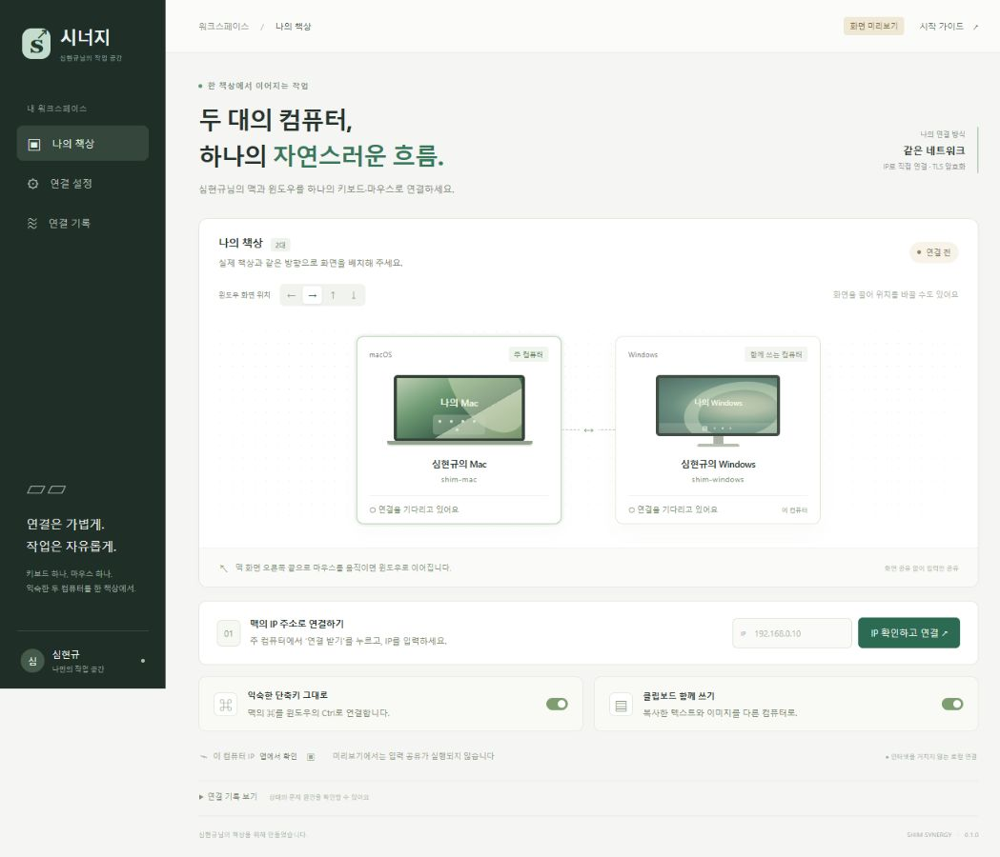

# 시너지 · 심현규님의 책상

맥과 윈도우를 하나의 키보드·마우스로 쓰는 한국어 데스크톱 앱입니다. 기본 주 컴퓨터는 맥이며, 연결 설정에서 윈도우를 주 컴퓨터로 바꿀 수 있습니다.



## 설치

[Releases](https://github.com/buriburi110/shim-synergy/releases)에서 자신의 컴퓨터에 맞는 파일을 받습니다.

| 컴퓨터 | 설치 파일 |
| --- | --- |
| 윈도우 x64 | `ShimSynergy-버전-win-x64.msi` |
| Apple Silicon 맥 | `ShimSynergy-버전-mac-arm64.pkg` |
| Intel 맥 | `ShimSynergy-버전-mac-x64.pkg` |

입력 공유 엔진은 설치 파일 안에 포함됩니다. 별도로 Deskflow를 설치할 필요가 없습니다. 초기 개인용 시험 버전이며, 개발자 인증서 서명과 Apple 공증은 아직 적용하지 않았습니다.

## 연결

1. 두 컴퓨터를 같은 공유기의 네트워크에 연결합니다.
2. 키보드·마우스가 연결된 주 컴퓨터에서 **연결 받기**를 누릅니다. 10분 동안 첫 연결 요청을 받습니다.
3. 다른 컴퓨터에 주 컴퓨터의 **IPv4 주소**를 입력합니다. 실제 네트워크 어댑터의 서브넷 마스크로 같은 대역인지 확인합니다.
4. 두 화면의 확인 번호가 같은지 확인합니다. 주 컴퓨터에서 **허용하고 연결**을 누릅니다.
5. 주 컴퓨터 화면에서 윈도우의 실제 위치를 지정합니다. 화면 끝으로 커서를 옮기면 다른 컴퓨터로 이어집니다.

처음 연결한 뒤에는 인증서가 저장됩니다. 다음부터는 **다시 연결하기**를 누르면 됩니다. IP가 바뀌었다면 새 IP를 입력한 뒤 다시 연결합니다. 이름이나 역할을 바꿀 때는 다시 승인받습니다.

앱이 실행 중인 상태에서 창을 닫으면 시스템 트레이에 남습니다. 트레이 아이콘을 누르거나 앱을 다시 실행하면 창이 열립니다. **연결 중지**는 입력 공유와 최초 연결 승인 대기를 함께 멈춥니다. 트레이의 **종료**는 엔진도 종료합니다.

### 맥에서 처음 실행할 때

시스템 설정 → 개인정보 보호 및 보안의 **손쉬운 사용**, **입력 모니터링**에서 번들에 포함된 **Deskflow**에 권한을 허용합니다. 필요하면 아래 경로의 앱/실행 파일을 선택합니다.

```text
/Applications/Shim Synergy.app/Contents/Resources/engine/Deskflow.app
/Applications/Shim Synergy.app/Contents/Resources/engine/Deskflow.app/Contents/MacOS/deskflow-core
```

권한을 변경한 뒤 앱의 연결을 중지했다가 다시 시작합니다. 실제 macOS 권한 허용과 두 컴퓨터 사이의 입력 전환 시험은 사용자 환경에서 확인해야 합니다.

### 연결이 안 될 때

- 주 컴퓨터의 앱이 켜져 있고 **연결 받기** 상태인지 확인합니다.
- 게스트 Wi-Fi나 공유기의 기기 간 격리 기능은 같은 대역이라도 연결을 막을 수 있습니다.
- 방화벽에서 사설 네트워크의 TCP **24800**(입력 공유), **24801**(최초 승인)을 허용합니다.
- 윈도우 관리자 권한 창·로그인 화면은 데스크톱 모드에서 조작할 수 없습니다. 로컬 입력 장치를 사용합니다.
- 클립보드와 단축키 변환은 주 컴퓨터에서 설정합니다. 한/영 전환은 각 OS의 입력기 설정에 따라 실제 맥·윈도우에서 확인해야 합니다.
- 상세 원인은 **연결 기록**에서 확인합니다. 앱은 실제 엔진 연결 로그가 들어오기 전까지 ‘연결됨’을 표시하지 않습니다.

## 개발 및 빌드

Node.js 24와 npm이 필요합니다.

```sh
npm ci
npm test
npm run engine:prepare
npm start
```

창 닫기·재열기·창 재생성·최소화 복구는 `npx electron scripts/lifecycle-smoke.cjs`로 확인합니다. 이 시험은 별도 임시 프로필을 사용하며 입력 공유를 시작하지 않습니다. GitHub 빌드는 단위·TLS 테스트와 실제 Electron 창 동작 시험이 통과한 뒤 설치 파일을 만듭니다.

화면만 확인할 때는 `npm run preview`를 실행하고 `http://127.0.0.1:4317`을 엽니다. 브라우저 미리보기는 키보드·마우스 공유를 실행하지 않습니다.

```sh
# Windows에서 MSI
npm run dist:win

# macOS에서 현재 CPU용 PKG
npm run dist:mac

# macOS에서 다른 CPU용 PKG
node scripts/prepare-engine.cjs arm64
npx electron-builder --mac --arm64 --publish never
```

GitHub에 `v0.1.0` 같은 버전 태그를 올리면 자동 테스트 후 Windows MSI와 macOS arm64/x64 PKG를 만들고 시험 릴리스에 첨부합니다. 정확한 Deskflow 엔진 소스 압축 파일도 함께 배포합니다.

## 구조와 근거

`app/model.cjs`는 배치와 엔진 설정, `app/pairing.cjs`는 같은 대역 확인·TLS 승인, `app/engine.cjs`는 실제 엔진 실행과 상태, `ui/`는 한국어 화면을 담당합니다. [분석 문서](docs/분석.md)에 원본 코드 위치, 확인한 사실과 검증 범위를 기록했습니다.

Synergy Stream의 공개 소스를 분석했으며 입력 공유에는 수정하지 않은 **Deskflow 1.27.0**을 사용합니다. Symless의 공식 제품이 아닙니다. [LICENSE](LICENSE), [제삼자 고지](THIRD-PARTY.txt)를 참조하세요.
