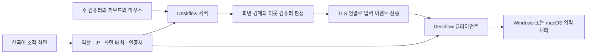

# Synergy 분해 분석과 개인용 재구성

분석 기준: 2026년 10월 20일. 입력 공유 방식은 공개 소스와 공식 배포물의 실제 실행으로 확인했습니다.

## 선택한 원본

- 사용자가 지정한 [Symless](https://github.com/symless) 조직의 `synergy` 저장소는 현재 공개 소스가 없는 안내 저장소입니다.
- [Synergy Stream](https://github.com/symless/synergy-stream/tree/c3f2e6942caec6a1faa77a498afbd1ddfb47c883)의 README는 Deskflow와 코드가 같고 브랜딩만 다르며, 소스만 배포한다고 명시합니다.
- 실행물은 [Deskflow 1.27.0](https://github.com/deskflow/deskflow/releases/tag/v1.27.0)의 공식 배포물을 고정하여 사용했습니다. 대응 소스 커밋은 `081f6478e654a112168879e67a41ce7d7e4ae3af`입니다.
- Synergy 3의 비공개 코드·계정·라이선스 기능은 재현하지 않았습니다. 공개된 입력 공유 엔진을 그대로 사용하고, 새 한국어 화면과 연결 절차를 구현했습니다.

## 어떻게 동작하는가

화면 영상을 전송하는 원격 데스크톱이 아니라, 키보드·마우스와 클립보드 이벤트를 전송하는 구조입니다.

| 관찰 지점 | 원본 소스에서 확인한 사실 | 새 앱에 반영한 내용 |
| --- | --- | --- |
| `src/lib/server/Server.cpp`, `getNeighbor`, `switchComputer` | 서버가 커서 위치와 인접 화면 관계를 보고 조작 대상을 전환 | 두 화면의 좌우·상하 배치를 직접 지정 |
| `src/lib/deskflow/ProtocolTypes.cpp:29` | 키 누름 `DKDL`, 기존 호환 `DKDN`, 키 놓음 `DKUP`, 마우스 이동 `DMMV`, 클립보드 `DCLP` 메시지 존재 | 이벤트 전송은 검증된 기존 엔진에 위임 |
| `src/lib/client/ServerProxy.cpp`, `keyDown`, `mouseMove` | 수신 메시지를 클라이언트의 입력 처리로 전달 | 새로운 입력 드라이버를 만들지 않고 Windows/macOS 구현 재사용 |
| `src/lib/net/SecureSocket.cpp:616` | 수신 인증서의 SHA-256 지문을 신뢰 파일과 비교 | 최초 승인에서 상호 지문을 저장하고 매 연결에서 엔진이 검증 |
| `src/lib/net/Fingerprint.cpp:34` | 신뢰 파일 레코드는 `v2:sha256:지문` 형식 | 그 형식으로 trusted-servers/trusted-clients 생성 |
| `src/apps/deskflow-core/CoreArgParser.cpp:54` | `--settings`로 INI 파일을 지정 | 기존 사용자의 Deskflow 설정과 분리된 앱 전용 설정 사용 |
| `src/lib/server/Config.cpp:441,630` | 1.27에서는 `screens` 섹션을 무시하고 INI의 `computer_*` 그룹에서 컴퓨터를 등록 | `[computer_이름]`과 `name`을 생성. 이 차이는 실제 실행 시험에서 재확인 |
| `src/lib/server/Config.cpp:535` | 클립보드·전환 지연 등 전역 옵션도 INI에서 읽음 | GUI 변경을 INI에 기록. 이전 `.conf` 옵션 형식에 의존하지 않음 |
| `src/lib/common/NetworkProtocol.h:10` | 엔진의 유효 프로토콜 옵션은 `synergy`, `barrier` | 양쪽에 동일한 `barrier` 프로토콜 사용 |

소스 경로는 위의 고정 커밋을 기준으로 합니다. 정적 코드에서 읽은 동작과 실행으로 확인한 범위를 구분합니다.

## 단순화한 연결 절차

주 컴퓨터에서 연결 받기를 켜면 10분 동안 HTTPS 승인 창구가 열립니다. 다른 컴퓨터는 IPv4를 입력합니다. 실제 어댑터의 넷마스크로 같은 대역인지 검사하고, 두 화면에 인증서에서 나온 같은 확인 번호를 표시합니다. 사용자가 주 컴퓨터에서 허용하면 공개 지문을 교환하고 엔진을 시작합니다. 인증서 개인키는 전송하지 않습니다.

승인 후에는 해당 창구를 닫으며, 다음 연결은 저장한 지문으로 검증합니다. 초기 IP 탐색만으로 상대 신원이 증명되는 것은 아니므로, 처음에는 두 화면의 확인 번호를 직접 대조해야 합니다.

## 확인한 것과 남은 것

- 실제 TLS 소켓을 사용한 자동 테스트: 인증서 저장, IP 탐색, 사용자 승인·거절, 잘못된 지문 거절, 일회용 토큰, 만료 코드와 큰 입력 거절.
- 배치·설정 테스트: 맥 기본 서버/윈도우 기본 클라이언트, 네 방향의 왕복 링크, 클립보드 설정, 키 변환 설정, 설정 삽입 방지, 실제 연결 로그에 따른 상태 전이.
- 네이티브 실행 시험: 한 윈도우 데스크톱에서 두 Deskflow 프로세스가 루프백으로 서로 다른 인증서를 제시하고, 양쪽 지문 검증 → TLS 1.3 → Barrier 1.8 핸드셰이크 → 클라이언트 연결 완료까지 통과.
- 이 네이티브 시험은 화면 간 링크를 비워 두고 입력을 생성하지 않았습니다. 실제 두 컴퓨터 사이의 커서 이동·클릭·한국어 입력·클립보드 왕복을 시험한 것은 아닙니다.
- macOS 입력 권한, macOS PKG 설치, 실제 Mac↔Windows 입력 전환은 별도 실기기 확인이 필요합니다. GitHub 빌드 성공만으로 이 항목을 완료했다고 판단하지 않습니다.
- GitHub Actions의 macOS 실행 환경에서 Apple Silicon용과 Intel용 PKG 생성은 통과했습니다. 빌드 중 엔진 CPU 종류도 검사합니다. [최초 빌드 기록](https://github.com/buriburi110/shim-synergy/actions/runs/39329116744)

## 유지보수

원본 엔진 버전과 다운로드 SHA-256은 `scripts/prepare-engine.cjs`에 고정되어 있습니다. 검증에 실패하면 엔진 준비를 중단합니다. 새로운 엔진으로 바꿀 때는 설정 스키마와 실제 핸드셰이크를 다시 검사해야 합니다. GPL과 원본 제삼자 고지를 유지하고, 릴리스에 대응 소스를 함께 제공합니다.
